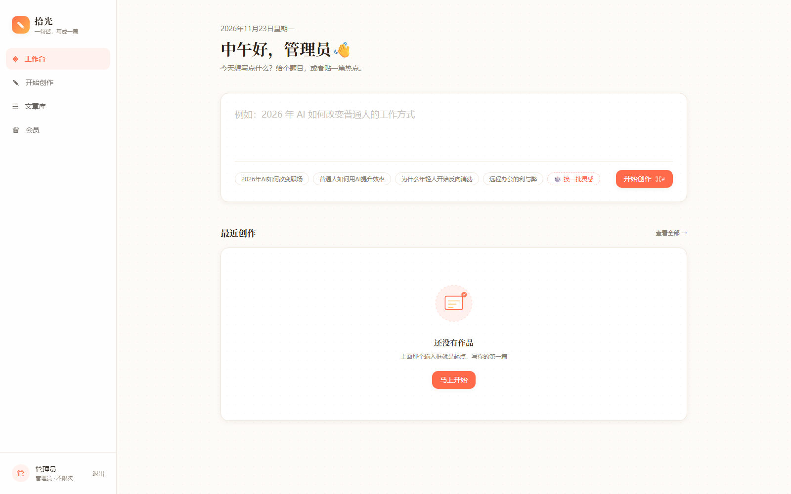
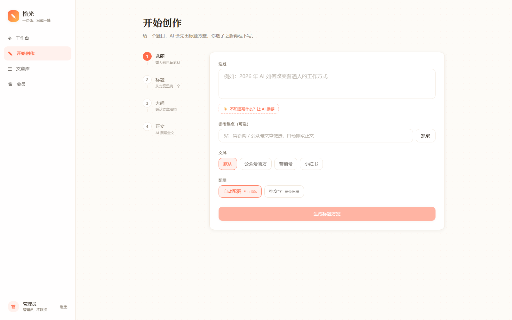
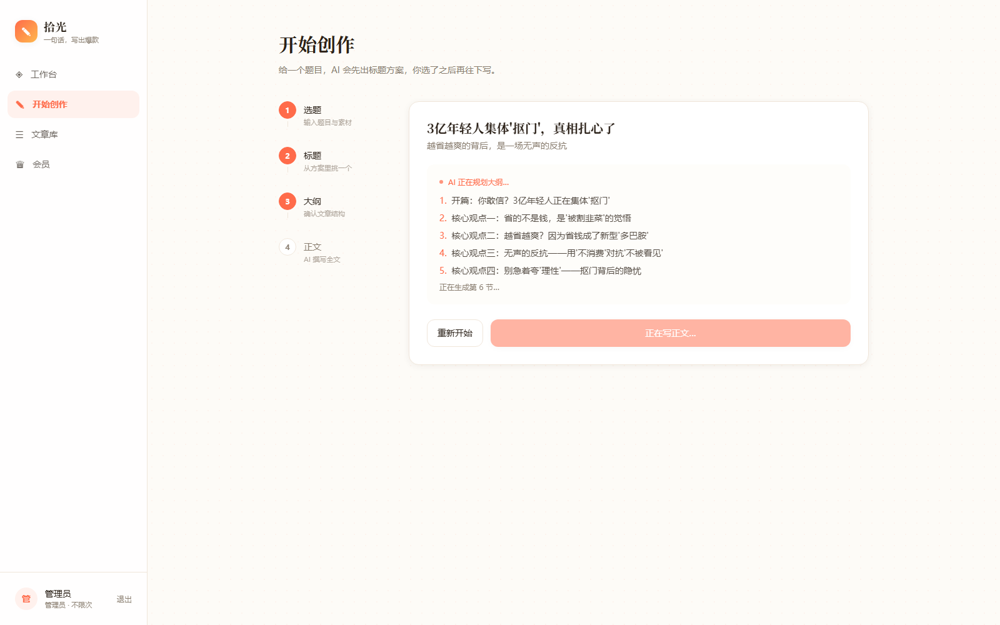
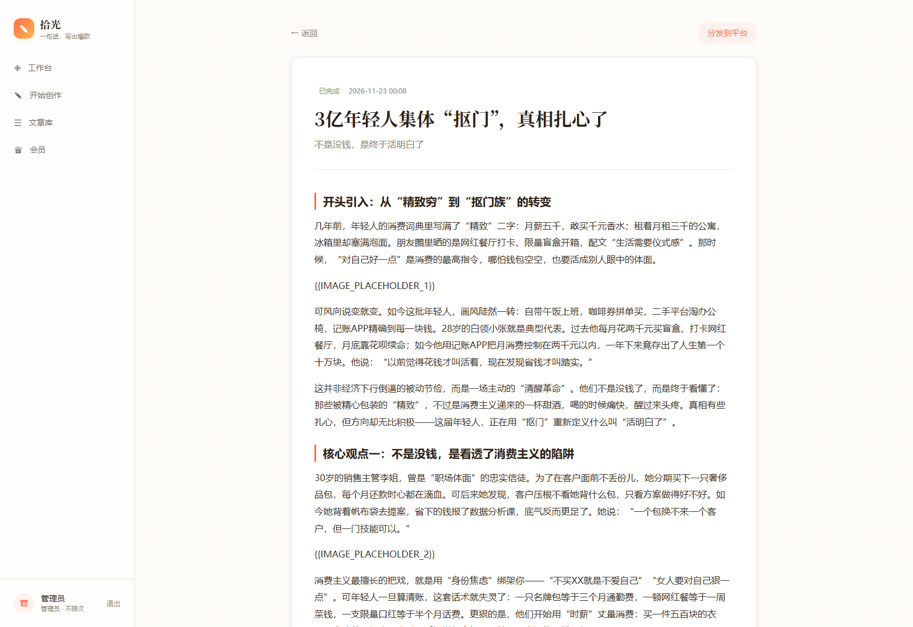
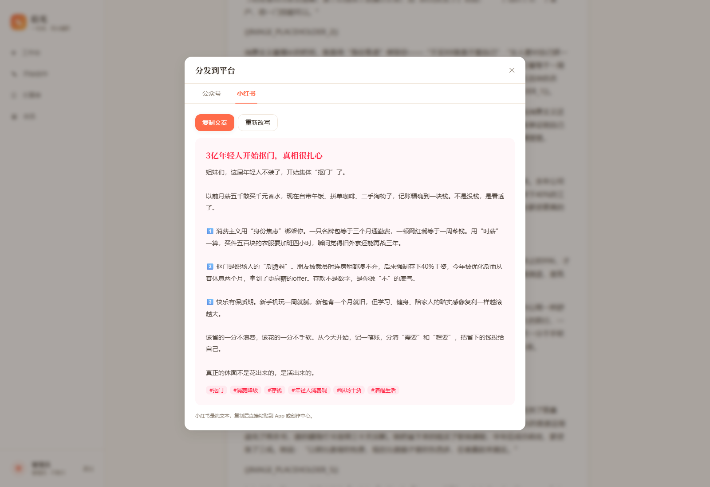

# 拾光 · AI 内容创作工作台

> 一句话命题，AI 替你写完一篇。

给一个选题（或让 AI 推荐），多智能体协作完成「标题 → 大纲 → 正文 → 配图」，支持抓取热点链接作为素材，最后把成稿适配成**微信公众号**和**小红书**可直接发布的格式。



## ✨ 核心功能

| 功能 | 说明 |
|---|---|
| **多智能体创作** | 5 个智能体分工协作：标题方案 / 大纲 / 正文 / 配图需求分析 / 配图生成，最后由合成智能体把图片插入正文 |
| **SSE 流式输出** | 大纲和正文逐字推送到前端，实时看到 AI 写作过程，不是转圈等结果 |
| **三阶段人机协作** | 标题选择 → 大纲确认 → 正文生成，每个环节都可以介入修改 |
| **热点素材抓取** | 贴一篇新闻/公众号链接，自动抽取正文注入 Prompt，让文章基于真实素材而不是空谈 |
| **AI 推荐选题** | 不知道写什么？按你选的平台调性推荐 5 个选题 |
| **平台化文风** | 公众号官方 / 营销号 / 小红书三种文风，各自的表达习惯写进 Prompt |
| **多平台分发** | 一键生成公众号内联样式 HTML（可直接粘贴），或让模型改写成小红书笔记 |
| **可选配图** | 纯文字 15 秒出稿，或自动配图约 45 秒，按需选择 |

## 🖼 界面预览

**创作流程（选题 → 标题 → 大纲 → 正文）**



**大纲流式生成中**



**文章详情**



**小红书改写成稿**



## 🏗 技术栈

**后端**：Python 3.12 · FastAPI · asyncio · OpenAI SDK（兼容 DeepSeek / 通义千问等）· SQLAlchemy 2.0 + databases · MySQL 8 · Redis · SSE

**前端**：Vue 3 · TypeScript · Vite · Tailwind CSS · Pinia · Vue Router · marked

**部署**：Docker · Docker Compose · Nginx

## 🚀 快速开始（Docker）

```bash
git clone <your-repo-url> shiguang
cd shiguang

# 1. 配置环境变量
cp .env.example .env
# 编辑 .env，至少填 DASHSCOPE_API_KEY（推荐 DeepSeek，便宜且够用）

# 2. 启动
docker compose up -d --build

# 3. 打开
# http://localhost:8090
```

默认账号：`admin` / `12345678`（另有 `user`、`test`，密码相同）

停止：`docker compose down`（数据保存在命名卷里，不会丢）

## 🛠 本地开发

```bash
# 后端
cd server
python -m venv .venv && source .venv/bin/activate   # Windows: .venv\Scripts\activate
pip install -e .
# 填好 .env 后启动
uvicorn app.main:app --reload --port 8667

# 前端
cd web
npm install
npm run dev        # http://localhost:5176，已配置 /api 代理到 8667
```

需要本机有 MySQL 8 和 Redis，建库执行 `sql/init.sql`。

## 🔧 配置说明

所有可配置项见 [`.env.example`](.env.example)。关键几项：

| 变量 | 作用 |
|---|---|
| `DASHSCOPE_API_KEY` | 大模型 Key（必填）。名字沿用自 DashScope，实际支持任意 OpenAI 兼容服务 |
| `DASHSCOPE_BASE_URL` | 模型服务地址，换供应商只改这里 |
| `DASHSCOPE_MODEL` | 模型名，如 `deepseek-chat`、`qwen-plus` |
| `PEXELS_API_KEY` | 图库配图（可选，不填会降级为随机图/图标） |
| `TENCENT_COS_*` | 图片托管（可选，不配则配图是外链） |
| `FRONTEND_PORT` | 前端对外端口，默认 8090 |

## 📁 项目结构

```
shiguang/
├── server/                    # 后端（FastAPI）
│   ├── app/
│   │   ├── routers/           # 接口层：article / user / payment / statistics
│   │   ├── services/          # 业务层：文章、智能体编排、配图策略、平台排版、热点抓取
│   │   ├── agent/             # 智能体层：编排器 + 5 个智能体适配器 + 并行配图
│   │   ├── managers/          # SSE 连接管理
│   │   ├── models/            # ORM 模型与枚举
│   │   ├── schemas/           # Pydantic 模型
│   │   └── constants/         # Prompt 模板等常量
│   └── Dockerfile
├── web/                       # 前端（Vue 3 + Vite）
│   ├── src/
│   │   ├── views/             # 页面：工作台 / 创作 / 文章库 / 详情 / 会员 / 登录
│   │   ├── layouts/           # 侧边栏布局
│   │   ├── api/               # 接口封装
│   │   └── styles/            # Tailwind 与全局样式
│   └── Dockerfile
├── sql/init.sql               # 建库建表 + 种子账号
├── docker-compose.yml         # 一键部署
└── docs/screenshots/          # 界面截图
```

## 🧠 几个设计要点

**为什么用 SSE 而不是 WebSocket**
AI 生成是单向推送、服务端主动、客户端只读，SSE 天然契合，还自带断线重连，比 WebSocket 轻。

**结构化输出怎么保证稳定**
模型输出并不总是规整的：可能被 ` ```json ` 包裹、前后带解释，甚至漏字段。做三层防护——Prompt 约束 + 宽松解析（剥代码块、正则提取）+ 字段默认值兜底。

**配图失败不该拖垮整篇文章**
配图属于增强能力。配图需求分析或图片生成失败时会自动降级为纯文字继续，同时清掉正文里残留的占位符。

**异步任务与进程重启**
创作任务跑在进程内（`asyncio.create_task`），进程重启任务就丢了。服务启动时会把残留的 `PENDING`/`PROCESSING` 任务统一标记为失败并写明原因，避免出现永远停在「生成中」的僵尸记录。

**逐张配图进度**
并行生成一开始是「全部完成才返回」，进度永远是 0。改成每张图完成就触发回调推 SSE，同时前端用状态轮询兜底，防止丢消息导致进度卡死。

## 📄 License

MIT
